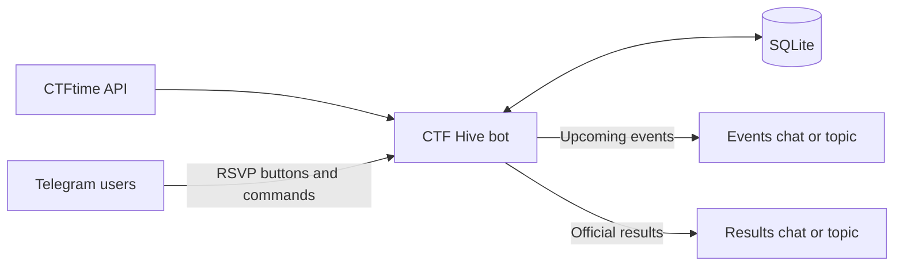

<div align="center">

# 🐝 CTF Hive

### Your CTF team's Telegram command center

**Upcoming events · Team RSVPs · Official results · One tidy hive**

[](https://www.python.org/)
[](https://docs.docker.com/compose/)
[](https://ctftime.org/api/)
[](https://core.telegram.org/bots/api)

</div>

---

CTF Hive watches [CTFtime](https://ctftime.org/) for upcoming **online Jeopardy CTFs**, posts polished event cards to your Telegram group, and lets teammates RSVP with one tap. When CTFtime publishes official results, the bot celebrates your team's placement in a dedicated chat or topic.

Built for [Shalena Bdj1lka](https://ctftime.org/team/451320/) and [Shalena Bdjilka](https://ctftime.org/team/376454/). You can change the monitored team IDs in `.env`.

> [!NOTE]
> The bot's current Telegram messages and buttons are in Russian. This README is in English; commands work exactly as shown below.

## ✨ Highlights

| | Feature | What it does |
| :---: | --- | --- |
| 📅 | **Event alerts** | Shows the title, CTFtime link, start and finish in Kyiv time, format, and location. |
| 🙋 | **One-tap RSVPs** | “Участвую” / “Не участвую” buttons update the attendee list and counters on the same card. |
| 🔄 | **Live corrections** | Changes to an event's title, time, format, or location edit the original message without losing votes. |
| 🏆 | **Team results** | Posts each monitored team's official placement and score after CTFtime publishes them. |
| 🧭 | **Flexible routing** | Send event alerts and results to the same topic, separate topics, or different chats. Configure destinations in a private conversation with the bot. |
| 🐝 | **Bee roll call** | `/all` or `/все` mentions known group members using randomly chosen bee-themed nicknames. |
| 💾 | **Persistent state** | SQLite keeps destinations, votes, and sent-message IDs across restarts. |

<details>
<summary><strong>How the pieces fit together</strong></summary>



The bot polls the [official CTFtime API](https://ctftime.org/api/) every three hours by default and announces events up to seven days ahead. Both intervals are configurable.

</details>

## 🚀 Quick start: Kali Linux + Docker

**Prerequisites:** Docker Engine and Docker Compose. Run these commands from the project directory:

```bash
cd tg_bot_ctf_time
cp .env.example .env
nano .env
```

Add the token issued by [@BotFather](https://t.me/BotFather) to `TG_BOT_TOKEN` in `.env`. Leave the other settings at their defaults to get started. Then launch the bot:

```bash
docker compose up -d --build
docker compose ps
docker compose logs -f bot
```

Press `Ctrl+C` to leave the log view; the container stays running. Useful follow-up commands:

```bash
docker compose down              # Stop the bot
docker compose up -d --build     # Rebuild and start after an update
```

> [!IMPORTANT]
> Run **only one instance per bot token**. If the bot is already running on Windows or another server, stop that instance before starting it on Kali. When moving hosts, copy the `data/` directory too; it contains your destinations, RSVPs, and IDs of messages already posted. Starting without it creates a fresh database.

## 🧭 Configure Telegram destinations

1. Add the bot to a Telegram group with topics. Add it to a second group or channel as well if results should go elsewhere. A channel requires the bot to be an administrator with posting permission.
2. Open a private chat with the bot and send `/start`.
3. Copy a link to the **topic itself** (its root message), such as `https://t.me/c/1234567890/42`, and send the link to the bot. Choose **“Анонсы”** (events), **“Результаты”** (results), or **“Оба сюда”** (both) from the buttons it shows.
4. For separate destinations, send the two links one after the other and choose a different button for each. Use `/status` to review the saved settings.

Prefer commands? Send these in the bot's private chat:

```text
/setevents https://t.me/c/1234567890/42
/setachievements https://t.me/c/1234567890/84
```

Use `/setboth https://t.me/c/1234567890/42` to send everything to one topic. An administrator can also run `/setevents`, `/setachievements`, or `/setboth` **inside the target topic**, with no link or ID.

For the main chat rather than a topic, use `/setboth CHAT_ID`. Numeric destinations are supported too: `/setevents CHAT_ID [TOPIC_ID]` and `/setachievements CHAT_ID [TOPIC_ID]`.

### Commands at a glance

| Command | Purpose |
| --- | --- |
| `/start` · `/help` | Show the in-bot setup guide. |
| `/chats` | Show chats the bot has seen, with destination buttons. |
| `/topics CHAT_ID` | Show discovered topics and destination buttons; a `t.me/c/...` link can replace the chat ID. |
| `/status` | Show current event and result destinations. |
| `/where` | Show the current chat and topic IDs. |
| `/setevents` | Set the destination for event announcements. |
| `/setachievements` | Set the destination for results. |
| `/setboth` | Set one destination for both. |
| `/nametopic Name` | Save the name of an older topic; run it inside that topic as a group administrator. |
| `/all` · `/все` | Mention known group members with bee-themed labels; group administrators only. |

Telegram suggests the Latin-letter commands when you type `/`. Type the Cyrillic alias `/все` manually.

## 🖼️ Event card preview

The example below mirrors the bot's Russian-language message; the event title and “Открыть на CTFtime” text are clickable in Telegram.

```text
🏴‍☠️ СКОРО CTF

Example CTF  ↗ CTFtime

📅 Начало: 17.10.2026 12:00
🏁 Конец: 18.10.2026 12:00
🕒 Время: Киев
🧩 Формат: Jeopardy · онлайн

👥 Участники (2)
• @player_one
• @player_two

✅ Участвуют: 2 · ❌ Не участвуют: 0
🔗 Открыть на CTFtime

[✅ Участвую]  [❌ Не участвую]
```

Each person can change their RSVP. The bot edits the existing card to update names and counts, and also edits that card if CTFtime changes the event details.

## ⚙️ Configuration and storage

The starter configuration lives in [`.env.example`](.env.example). Copy it to `.env` and set the token there.

| Setting | Default | Meaning |
| --- | --- | --- |
| `TG_BOT_TOKEN` | Required | Telegram bot token from @BotFather. |
| `CTFTIME_TEAM_IDS` | `451320,376454` | Comma-separated CTFtime team IDs to monitor. |
| `EVENT_LOOKAHEAD_DAYS` | `7` | How far ahead to announce CTFs. |
| `CHECK_INTERVAL_MINUTES` | `180` | Time between CTFtime checks. |
| `RESULT_BACKFILL_DAYS` | `14` | How far back to check results on first run. |
| `DB_PATH` | `data/bot.sqlite3` | SQLite database path. |

Destinations can be changed later in Telegram without restarting the bot. The Docker Compose setup mounts `./data` into the container, so the database survives rebuilds and restarts.

> [!CAUTION]
> Keep `.env` private: anyone with the token can control the bot. Both `.env` and `data/` are already excluded by `.gitignore`; do not force-add them to Git.

## 🐝 Bee roll call

In a group or topic, an administrator can send `/all` (or `/все`). The bot replies with clickable user mentions hidden behind randomly chosen bee-themed labels. It can be called again after ten minutes.

The Telegram Bot API does **not** provide a complete roster of existing group members. The bot remembers people who message the group after it joins, join later, or press an RSVP button, and also adds group administrators. Make the bot a group administrator so it receives ordinary messages and can build that list.

## ℹ️ Telegram and CTFtime details

- **Topic names:** Telegram sends topic names to bots when topics are created or renamed. It does not expose a list of older topics through the Bot API, even to administrators. Run `/nametopic Name` once inside an older topic to label it in `/topics` and `/status`.
- **Official results:** A result appears only after CTFtime publishes it. If both monitored teams compete in the same event, each gets its own result post.
- **No duplicate event cards:** Polling and restarts reuse previously posted messages. If a destination changes, new cards go to the new destination while older cards continue to update in their original chat.

## 🛠️ Run without Docker

Python 3.12 or newer is required. After copying `.env.example` to `.env` and setting `TG_BOT_TOKEN`:

```bash
python3 -m venv .venv
. .venv/bin/activate
pip install -r requirements.txt
python bot.py
```

On Windows, [`install-task.ps1`](install-task.ps1) installs the bot as a background task that starts when you sign in.

<div align="center">

**Made for teammates who would rather solve challenges than chase event links.** 🐝

</div>
